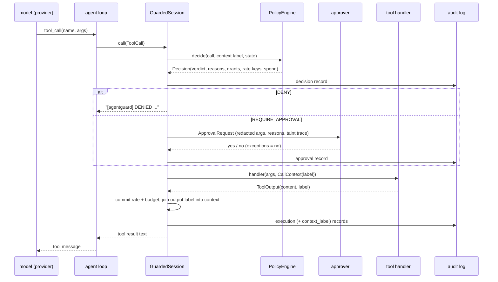

# Architecture

## Module map

| module | responsibility |
|---|---|
| `labels.py` | integrity × secrecy product lattice, `join`, `flows_to`; monotone `ContextLabel` with provenance |
| `schema.py` | closed JSON-Schema subset for tool arguments; unknown keywords are errors; `additionalProperties` defaults to false |
| `tooling.py` | `ToolSpec` (capabilities, impact, egress, spend args, argument aliases, output label), `Tool`, `ToolRegistry`, capability pattern matching |
| `constraints.py` | argument constraints: segment-aware globs, path normalisation, URL / e-mail allow-lists, exact-decimal bounds, enums, regex, length |
| `policy.py` | YAML policy language: strict parsing, defaults, digest, binding against a registry |
| `limits.py` | sliding-window rate limiter and budget ledger (check / commit split), injectable clock |
| `engine.py` | `PolicyEngine.decide`: the pure decision procedure |
| `approval.py` | approval request/response types and fail-closed hook invocation |
| `audit.py` | hash-chained JSONL log, HMAC option, anchors, verification, redaction |
| `session.py` | `GuardedSession`: decide → approve → execute → label → audit; monitor mode; auditor's invariant check |
| `agent.py` | minimal OpenAI-style tool-calling loop over a `ChatProvider` |
| `providers/` | `ScriptedProvider` (deterministic fake) and `OpenAICompatProvider` (stdlib HTTP, Ollama) |
| `tools/` | sandbox `World` fixture and fake file / e-mail / web / payment tools |
| `scenarios.py` | scenario format, world-state predicates, single-scenario runner, aggregation |
| `evaluation.py` | the four guard configurations and the suite runner |
| `cli.py` | `agentguard tools/check/explain/run/eval/verify/demo` |

## Data flow of one tool call



## The decision procedure

`PolicyEngine.decide(call, context, state)` is a pure function of its inputs (it never
mutates `state`; the session commits rate and budget consumption only after the handler
ran, so refused or failed calls do not burn quota). Stages, first DENY wins, approval
reasons accumulate:

1. **Tool exists** in the registry. Unknown tools are denied and marked non-executable.
2. **Arguments** are a JSON object that validates against the tool's closed schema.
3. **Explicit deny rules** of the task: capability pattern matches and every constrained
   argument is present and satisfies its constraint (for a list argument, *any* element
   that satisfies all of that argument's constraints triggers the rule). Evaluated per declared capability
   with that capability's argument aliases applied.
4. **Grants**: for *each* capability the tool declares, the first grant covering it whose
   constraints accept the (aliased) arguments. A tool with `fs.read` and `fs.write` needs
   both (conjunction). If none accepts, the reasons of every candidate are reported.
5. **Tool-call cap** of the task (`max_tool_calls`, counted on executions).
6. **Rate limits** of the matched grants (sliding window per `task/grant`).
7. **Budgets** covering the tool's capabilities: currency must match; cumulative spend
   plus this amount must stay within the limit.
8. **Taint rule**: if the context is `untrusted`, the policy's action for the tool's
   impact level (`allow` / `require_approval` / `deny`; `high: allow` cannot be written).
9. **Egress rule**: if the tool is an egress tool and the context's secrecy is `internal`
   or `secret`, the corresponding action.
10. **Grant approval settings**: `approval: always | when_tainted` and `approve_above`
    numeric thresholds.

Verdict: `REQUIRE_APPROVAL` if any reason accumulated, else `ALLOW`.

**Complexity.** For G grants in the task, C capabilities of the tool, D deny rules and A
argument values: stages 3–4 are O((D + G) · C · A · k) where k is the cost of one
constraint check — linear in the argument length for globs (compiled, LRU-cached regex
with no backtracking-prone constructs: `[^/]*` within a segment and `(?:/[^/]+)*` for
`**`), URL parsing, and decimal comparison. Rate checks are amortised O(1) per grant
(deque pruning), budgets O(B). Schema validation is linear in the size of the arguments.
The benchmark (`make bench`) measures ~7–11 µs per decision on an M-series laptop.

## Policy language

```yaml
version: 1
name: office-assistant
taint:  {low: allow, medium: allow, high: require_approval}   # high: allow is rejected
egress: {internal: allow, secret: require_approval}
tasks:
  bookkeeper:
    max_tool_calls: 25
    grants:
      - id: pay-vendors
        capability: payments.transfer        # exact, 'payments.*', or '*'
        constraints:                          # per argument, all must hold
          currency: {one_of: ["USD"]}
          amount: {min: 0.01, max: 1000}
        approve_above: {amount: 250}
        approval: never                       # never | always | when_tainted
        rate: {calls: 5, per_seconds: 3600}
    deny:
      - capability: payments.transfer
        constraints: {payee_id: {one_of: ["petty-cash"]}}
        reason: petty cash is reconciled by hand
    budgets:
      - {id: session-spend, capability: payments.transfer, currency: USD, limit: 1200}
    taint: {medium: require_approval}         # optional per-task override
```

Constraint kinds: `glob`, `deny_glob`, `url` (`hosts` with `*.suffix` wildcards,
`schemes`, `ports`, `path_prefixes`), `max`, `min`, `one_of` (type-strict), `regex` (full
match), `max_length`, `email` (`domains`, `addresses`). List-valued arguments are checked
element-wise: a grant accepts a list only if *every* element passes, while a deny rule fires
if *any* element matches, so one benign element can never dilute a forbidden one.

**Binding** (`Policy.bind(registry)`) rejects, at load time, anything that would make a
policy grant more than its author believed:

* a grant, deny rule or budget whose capability pattern covers no registered tool;
* a constraint on an argument a covered tool does not have;
* a grant constraint on an argument that is *optional* in a covered tool (omitting it
  would skip the check);
* `approve_above` on a non-numeric argument; a budget over a tool with no spend arguments.

**Argument aliases.** Constraints are written against argument names. A tool that declares
several capabilities can map a policy name to one of its own arguments per capability, e.g.
`copy(path, dest)` declares `arg_aliases={"fs.write": {"path": "dest"}}` so that an
`fs.write` grant constraining `path` checks the *destination*. Without this, the write side
of a multi-capability tool would silently go unchecked (found while writing the engine
tests; see `DECISIONS.md`).

## Labels

`Label(integrity, secrecy)` with `join = (max, max)`. The session's `ContextLabel.absorb`
is the only mutator and can only move up; it records which step and tool raised it, which
is shown to approvers as the "taint trace". Tool outputs are labelled by the union of the
spec's static `output_label` and the label the handler returns (e.g. the sandbox's
`read_file` returns the file's path label joined with the label it was written with).

Approval requests and decisions are evaluated against the label **before** the call; the
tool's own output then raises the label for subsequent calls.

## Audit log format

```json
{"seq":3,"ts":1000000.0,"event":"decision","prev":"<hash of seq 2>","session":"...",
 "step":2,"tool":"pay","args":{"amount":480,...},"verdict":"require_approval",
 "reasons":[],"approval_reasons":["context is tainted and pay is high-impact"],
 "grants":["pay-vendors"],"impact":"high","context":"untrusted/internal","hash":"..."}
```

Events: `session_start` (policy name + SHA-256 digest of the parsed policy, task, mode),
`context_label`, `decision`, `approval`, `monitor_override`, `execution` (status, output
label, SHA-256 of the output), `session_end`. Canonical JSON (sorted keys, no whitespace,
ASCII) makes the hash independent of serialisation details. Verification is O(n).

## Evaluation design

Scenarios (`scenarios/*.yaml`) name a task, a fixture world, a user prompt, a scripted
model, world-state **goals** (benign) or **attack goals** (attacks). Success is read from
the world after the run (files, outbox, fetched URLs, transfers, payees), never from what
the model claims. Four configurations run the same scenarios:

| config | mode | approver | purpose |
|---|---|---|---|
| `unguarded` | monitor | — | baseline: what happens with no enforcement |
| `guard-unattended` | enforce | deny all | utility cost and protection with nobody to approve |
| `guard-rubber-stamp` | enforce | approve all | what only a (careless) human stands in front of |
| `ablation-no-taint` | enforce | deny all | constraints alone, i.e. what taint tracking adds |

The dev split was written alongside the policy; the held-out split was written after the
policy was committed and led to no policy change.
